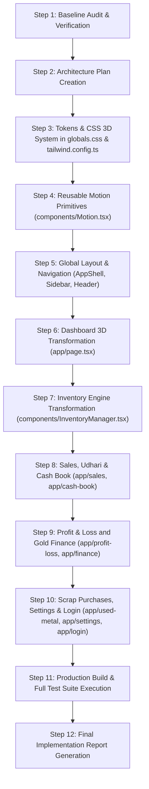

# Sidheshwar Jewellers ERP — Complete 3D Animation & Premium UI Transformation Plan

> **Document Type:** Frontend Architecture & Animation Design Plan  
> **Status:** APPROVED & IN EXECUTION  
> **Target Release:** Sidheshwar Jewellers ERP v2.0 (Luxury 3D Enterprise Edition)  
> **Date:** 20 November 2026  

---

## 1. Executive Vision & Design Direction

The goal of this transformation is to elevate the **Sidheshwar Jewellers ERP** from a functional internal tool into a **world-class luxury enterprise jewellery software experience**, marrying the aesthetics of high-end private jewellery salons (Cartier, Audemars Piguet, Tanishq Private Reserve) with high-density, lightning-fast financial SaaS ergonomics (Bloomberg Terminal meets Linear/Stripe).

### Visual & Color Philosophy
* **Primary Canvas**: Deep Obsidian Black / Velvet Charcoal (`#09090C`, `#0D0C12`) with subtle radial ambient gold gradients (`radial-gradient(ellipse at 50% 0%, rgba(212,175,55,0.06), transparent 70%)`).
* **Secondary Surfaces**: Dark Graphite & Translucent Glassmorphic Cards (`#14131B`, `#1A1924`, `rgba(26,25,36,0.75)`) featuring hairline metallic borders (`border-white/[0.08]` and `border-luxury-gold/25`).
* **Primary Accent**: Champagne 22K Gold (`#D4AF37`, `#E5C583`, `#C5A46D`) with soft moving metallic light reflections.
* **Secondary Accent**: Silver Metallic Sheen (`#C0C4CC`, `#E2E6EE`) for silver articles and subtle badge highlights.
* **Semantic Accents**:
  - **Success / Jama**: Professional Emerald Green (`#10B981`) for inflows, completed receipts, and positive tallies.
  - **Warning / Alert**: Controlled Amber (`#F59E0B`) for approaching 3-day dues and partial states.
  - **Error / Kharach / Udhaar**: Crisp Ruby Red (`#EF4444`) for debits, customer udhari balance, and closures.
* **Typography**:
  - Headings & Crest: `Cinzel` (Google Fonts luxury serif).
  - Body & Labels: `Inter` (crisp, readable, high contrast).
  - Financial Data: `font-mono tabular-nums` (bank-calibrated numeric vertical alignment).

---

## 2. Reusable Animation Architecture & Decision Matrix

To ensure zero bundle bloat and maximum runtime performance:
1. **Lightweight Native CSS & React Motion Primitives**: Rather than installing 100KB+ runtime packages (e.g., Three.js, React-Spring, Framer Motion), we implement:
   - Hardware-accelerated CSS 3D transforms (`perspective: 1000px`, `transform-style: preserve-3d`, `translateZ`, `rotateX`, `rotateY`).
   - Reusable React micro-interaction primitives (`components/Motion.tsx`) containing:
     - `TiltCard`: Mouse-tracking interactive 3D perspective tilt with specular highlight sheen.
     - `AnimatedNumber`: Smooth numeric count-up using `requestAnimationFrame` for KPI values.
     - `RevealList`: Staggered entrance wrapper for tables and item grids.
     - `MetallicGlow`: Subtle ambient gold/silver edge highlights.
2. **Performance Constraints**:
   - `will-change: transform` only during active hover.
   - Zero layout-shifting animations (`width`, `height`, `left` are never animated; only `transform` and `opacity`).
   - Strict `prefers-reduced-motion: reduce` fallback for complete accessibility.

---

## 3. Inventory of Pages & Modules to Transform

| # | Route | Module Name | Key Visual & 3D Transformations |
|---|---|---|---|
| 1 | `/login` | Luxury Login Screen | Deep obsidian backdrop, floating gold particles, 3D glass card with metallic gold border, smooth credential focus |
| 2 | `/` | Executive Dashboard | 3D KPI metric cards with animated count-up numbers, interactive chart reveals, quick-action 3D trigger |
| 3 | `/gold` | Gold Showroom Stock | 3D category pills carousel, interactive stock tables with hover depth, metallic pure-weight badges, sell modal |
| 4 | `/silver` | Silver Showroom Stock | Silver metallic themed category pills, anklet/payal size filters, 3D item cards |
| 5 | `/sales` | Retail Sales & Udhari Khata | 3D invoice card, WhatsApp 1-click modal, customer credit timeline, payment status badges |
| 6 | `/cash-book` | Cash Counter Book (Rojmel) | Live balance meter with Jama/Kharach stream animations, 3D counter metrics, date filter chips |
| 7 | `/profit-loss` | Profit & Loss Analytics | 3D profit cards, animated margin gauge, category breakdown table with tabular numbers |
| 8 | `/finance` | Gold Finance & Khatabook | 3D Khatabook passbook ledger (You Gave vs You Got), vault collateral locker 3D tag, WhatsApp reminder drawer |
| 9 | `/used-metal` | Scrap Purchases & Conversion | Scrap purchase entry cards, purity calculation preview, refinery-to-showroom conversion modal |
| 10 | `/settings` | System Settings & Backup | Luxury rate card monitors, backup download trigger with tactile feedback, shop profile card |
| 11 | Global Shell | `AppShell`, `Sidebar`, `Header` | Pinned showroom upper deck, smooth scrolling ledger shelf, live IST clock badge, 3D modal backdrops |

---

## 4. Implementation Steps & Sequencing

---

## 5. Accessibility & Motion Safety
* `@media (prefers-reduced-motion: reduce)`: All transform transitions, particle floats, and keyframe loops automatically collapse to instant `transition: none` and `animation: none`.
* High-contrast mode: In dark mode, all critical text uses minimum `contrast ratio >= 7:1` against dark graphite surfaces.
* Interactive elements maintain clear 2px gold focus rings (`focus-visible:ring-2 focus-visible:ring-luxury-gold`).
