# MASTER IMPLEMENTATION REPORT — 3D ANIMATION & LUXURY UI TRANSFORMATION
## Sidheshwar Jewellers ERP — Complete Enterprise Frontend Overhaul

**Target System:** Sidheshwar Jewellers Sarafa ERP  
**Architecture:** Next.js 14 App Router, React 18, TypeScript, Tailwind CSS, Native CSS 3D Transforms, MongoDB  
**Theme:** Premium Luxury Jewellery + Modern 3D Enterprise ERP  
**Audit & Build Status:** 100% Passed (All 25 application routes compiled & verified)  

---

## 1. Executive Summary

This report documents the complete visual and interaction overhaul of the **Sidheshwar Jewellers ERP** application. The entire user interface has been elevated from a traditional flat layout into a **luxury jewellery brand enterprise suite**, combining:

1. **Deep Obsidian & Dark Graphite Surfaces:** Eliminating harsh pure whites and distracting neon glows, replaced with deep obsidian (`#09090C`), rich graphite (`#16151E`), and dark glass panels (`backdrop-blur-xl`).
2. **Champagne Gold & Silver Metallic Accents:** Sophisticated warm champagne gold (`#C9A84C` / `#E5C583`) and fine silver (`#C0C4CC` / `#E8ECF2`) specular highlights reflecting real jewellery craftsmanship.
3. **Hardware-Accelerated 3D Motion System:** Created reusable React primitives (`TiltCard`, `AnimatedNumber`, `GlassCard`, `PulseDot`) powered by native CSS 3D perspectives (`perspective: 1000px`, `transform-style: preserve-3d`), dynamic mouse-tracking specular glares, and spring-eased numeric count-ups—with **zero heavy external bundle bloat** (no Three.js or WebGL overhead).
4. **Resolution of User Layout Observations:**
   - **Duplicate Sidebar:** Resolved layout structure in [AppShell.tsx](file:///Users/virajlengare/Downloads/siddheshwar%20jewllers/components/AppShell.tsx) ensuring no nested shell duplication.
   - **Pinned vs. Scrollable Sidebar Navigation:** Organized the sidebar into a **pinned static Core Showroom deck** (Dashboard, Gold Stock, Silver Stock, Sales & Udhari) and an independently **scrollable Ledgers deck** (Cash Book, Profit & Loss, Used Metal, Gold Finance, Settings).
   - **Khatabook Girvi Engine:** Refined the dual-panel **Grahak Khata Book (खाते पुस्तक)** inside Gold Finance, providing instant "You Gave (दिले / Udhaar)", "You Got (मिळाले / Jama)", vault collateral tracking, and 1-click WhatsApp statements.
5. **Full Accessibility Compliance:** Every 3D transform, perspective shift, and numeric count-up automatically respects `@media (prefers-reduced-motion: reduce)`.

---

## 2. Luxury Design System & Color Tokens

| Token | Hex / Value | Semantic Role in Sarafa ERP |
|---|---|---|
| **Deep Obsidian Black** | `#09090C` / `#0A090D` | Primary application canvas, root backdrop, modal backdrops |
| **Dark Graphite** | `#16151E` / `#1C1B26` | Card bodies, table containers, sidebar, elevated drawers |
| **Champagne Gold** | `#C9A84C` | Primary jewellery accent, gold weights, 24K/22K badges, CTA borders |
| **Warm Gold Glow** | `rgba(201, 168, 76, 0.25)` | Specular glares, active indicators, live count focus rings |
| **Silver Metallic** | `#C0C4CC` / `#E8ECF2` | Silver showroom assets, anklets, fine silver weights, secondary buttons |
| **Professional Green** | `#10B981` (Emerald) | Net realized owner profits, Jama (inflows), cleared udhari accounts |
| **Controlled Amber** | `#F59E0B` (Amber) | Customer udhari dues, overdue alerts, maturity reminders |
| **Clear Red** | `#EF4444` (Rose) | Kharach (expenses), Udhaar given, overdue warnings, critical alerts |
| **Metallic Hairline** | `rgba(255, 255, 255, 0.08)` | Structural grid divisions, glassmorphism borders |

---

## 3. Centralized Reusable 3D Motion Architecture

All animations and 3D interactions are managed through centralized components and CSS utility classes:

### 3.1 Components in [components/Motion.tsx](file:///Users/virajlengare/Downloads/siddheshwar%20jewllers/components/Motion.tsx)
- **`TiltCard`**: Interactive mouse-tracking perspective tilt (`rotateX`, `rotateY`, `translateZ(12px)`) that dynamically calculates the cursor's coordinates relative to the card's bounding box and casts a specular radial glare sheen across the surface.
- **`AnimatedNumber`**: 60fps numeric counter utilizing `requestAnimationFrame` and an exponential ease-out curve (`1 - 2^(-10 * progress)`). Supports localized INR formatting (`en-IN`), customizable decimal places (e.g. `3` decimals for milligram-accurate bullion weights), and currency prefixes.
- **`GlassCard`**: Dark graphite container featuring refined glassmorphism, metallic hairline borders, and subtle elevation.
- **`PulseDot`**: Live status heartbeat indicator with pulsating outer ring for live counter balance and live showroom operations.

### 3.2 Global CSS 3D Utilities in [app/globals.css](file:///Users/virajlengare/Downloads/siddheshwar%20jewllers/app/globals.css)
- `.perspective-1000`: Applies `perspective: 1000px` for authentic spatial depth.
- `.preserve-3d`: Maintains `transform-style: preserve-3d` across nested elements.
- `.card-3d`, `.card-3d-gold`, `.card-3d-silver`: Tactile elevation classes with subtle shadow lifts.
- `.btn-3d`: Press-down tactile micro-interaction (`active:scale-[0.97] active:translate-y-0.5`).
- `.metallic-sheen`: Ambient light shimmer sweep for premium surfaces.
- `@media (prefers-reduced-motion: reduce)`: Global killswitch disabling perspective rotation, animations, and transitions for motion-sensitive users.

---

## 4. Page-by-Page Transformation Breakdown

```mermaid
flowchart TD
    Shell["AppShell & Persistent Dark Obsidian Layout"]
    Shell --> Nav["Sidebar: Pinned Showroom + Scrollable Ledgers"]
    Shell --> TopBar["Header: Live IST Time Pill + 3D Quick Action"]
    
    Shell --> P1["Executive Dashboard (3D Tilt Cards & Live Metric Counters)"]
    Shell --> P2["Gold & Silver Stock (Dynamic Weight/Size Carousel & 3D Table)"]
    Shell --> P3["Sales & Udhari (Due Alerts, WhatsApp Khata Reminders & Recovery)"]
    Shell --> P4["Cash Book / Rojmel (Live Counter Meter & Jama/Kharach Streams)"]
    Shell --> P5["Profit & Loss (Realized Net Margins & Metal-wise Split)"]
    Shell --> P6["Gold Finance & Khatabook (Dual-panel Grahak Vault Ledger)"]
    Shell --> P7["Used Metal & Scrap (Independent Acquisition & Refine Conversion)"]
    Shell --> P8["Settings (Live Benchmark Rates & CSV Backup Center)"]
    Shell --> P9["Portal Login (Obsidian Ambient Glow & 3D Glass Medallion)"]
```



### 4.1 Executive Dashboard ([app/page.tsx](file:///Users/virajlengare/Downloads/siddheshwar%20jewllers/app/page.tsx))
- **Showroom Metals & Finance Portfolio:** 4 primary KPI cards wrapped in `TiltCard` with gold/silver accents, featuring milligram-accurate bullion figures animated via `AnimatedNumber`.
- **Cash Counter & Sales Stream:** Dark graphite cards displaying Live Cash in Counter, Realized Profit in emerald green (`+₹...`), Pending Udhari in amber, and Due Alerts.
- **Overdue Action Banner:** Glassmorphic amber container highlighting past-maturity finance pledges.
- **Quick Module Hub & Live Activity Feed:** Micro-cards with tactile hover transforms and a live pulsing status indicator.

### 4.2 Gold & Silver Showroom Managers ([components/InventoryManager.tsx](file:///Users/virajlengare/Downloads/siddheshwar%20jewllers/components/InventoryManager.tsx))
- **Live Stock Summary Cards:** Pieces in stock, gross weight, net metal weight, and active category count with specular glare.
- **Category Carousel:** Glassmorphic pills highlighting live pieces and net weight per category with 1-click filtering.
- **Search & Segregation Deck:** Weight bracket filters (`< 2g`, `2-5g`, `5-10g`, `10-20g`, `> 20g`), size dropdowns, and purity filters on dark glass inputs.
- **Stock Grid & Modals:** High-contrast tabular rows with HUID verification badges, 3D "Sell" button, non-destructive adjustment, and modal windows with obsidian backdrop blur.

### 4.3 Sales & Customer Udhari Khata ([app/sales/page.tsx](file:///Users/virajlengare/Downloads/siddheshwar%20jewllers/app/sales/page.tsx))
- **Metrics Deck:** Total Sales Volume, Realized Profit, Total Outstanding Udhari, and Scheduled Reminders.
- **Status Filter Chips:** Dynamic switching between All Sales, Pending Udhari, Due in 3 Days, Overdue Accounts, and Settled.
- **Sales Ledger Table:** Customer contact details, item specs, net weight, profit badges, and promised due dates.
- **1-Click WhatsApp Reminders:** Automated Marathi & English WhatsApp reminder links pre-populated with customer name, item, pending balance, and promised due date.
- **Udhari Recovery Modal:** Quick cash counter credit and payment receipt generation.

### 4.4 Cash Counter Book — Rojmel ([app/cash-book/page.tsx](file:///Users/virajlengare/Downloads/siddheshwar%20jewllers/app/cash-book/page.tsx))
- **Live Cash in Counter Hero:** Prominent 3D gold card tracking the exact net cash in the shop drawer.
- **Jama & Kharach Stream:** Jama (credits/inflows) displayed in emerald green (`+₹...`), Kharach (debits/expenses) in clear red (`-₹...`), and Net Daily Movement.
- **Quick Rojmel Filter:** Today, Yesterday, Past 7 Days, This Month, and All Records.
- **Record Cash Entry Modal:** Quick toggles for shop expenses, karigar wages, cash additions, and owner withdrawals.

### 4.5 Profit & Loss Analytics ([app/profit-loss/page.tsx](file:///Users/virajlengare/Downloads/siddheshwar%20jewllers/app/profit-loss/page.tsx))
- **Executive Margins:** Total Showroom Revenue, Realized Net Profit (emerald green), Average Margin %, and Pending Customer Udhari.
- **Metal Breakdown:** Gold Showroom Sales vs. Silver Showroom Sales performance stream.
- **Category Matrix Table:** Pieces sold, revenue, profit, and margin % per category (Rings, Chains, Anklets, etc.) with tabular numerals.

### 4.6 Gold Finance & Authentic Khatabook System ([app/finance/page.tsx](file:///Users/virajlengare/Downloads/siddheshwar%20jewllers/app/finance/page.tsx))
- **Master Khatabook Banner:**
  - **You'll Get (घेणे बाकी):** 3D gold tilt card totaling all active loan dues.
  - **Vault Gold Collateral (गहाण सोने):** Total grams and ornaments held in the shop safe.
  - **You'll Give (देणे बाकी):** Client advance credit balances.
- **Split-Screen Layout:**
  - **Left Grahak Directory:** Searchable customer list with search bar, status filters (All, Dues Pending, Overdue), pledged weight badges, and outstanding balances.
  - **Right Customer Ledger (खाते वही / पासबुक):** Selected borrower statement with 1-click WhatsApp Khatabook Statement, Call, and Print buttons.
  - **Passbook Flow:** "You Gave (दिले / Udhaar)" in clear red and "You Got (मिळाले / Jama)" in emerald green, with quick "Receive Payment" action on every voucher.
  - **Sticky Action Bar:** Direct buttons for `+ You Gave (नवीन गहाण / कर्ज द्या)` and `+ You Got (रक्कम जमा करा)`.

### 4.7 Used Metal & Scrap Acquisition ([app/used-metal/page.tsx](file:///Users/virajlengare/Downloads/siddheshwar%20jewllers/app/used-metal/page.tsx))
- **Strict Custody Isolation:** Completely isolated from showroom stock until refined.
- **Gold & Silver Scrap Tabs:** Outlay tracking, net weight acquired, and refining status.
- **Refine & Convert Modal:** Allows master jeweller to refine scrap metal and explicitly transfer it into a showroom stock category with target purity and weight.

### 4.8 System Settings & CSV Data Center ([app/settings/page.tsx](file:///Users/virajlengare/Downloads/siddheshwar%20jewllers/app/settings/page.tsx))
- **Daily Benchmark Rates Card:** Live updates for 24K, 22K, 18K Gold, and Fine Silver per gram.
- **Shop Profile & Defaults:** Shop name, phone, address, and default monthly mortgage rate.
- **Data Export Center:** 1-click CSV downloads for Gold Inventory, Silver Inventory, Used Metal Scrap, and Finance Portfolio.
- **System Audit Trail:** Real-time immutable event log of all administrative and financial changes.

### 4.9 Luxury Portal Login ([app/login/page.tsx](file:///Users/virajlengare/Downloads/siddheshwar%20jewllers/app/login/page.tsx))
- **Ambient Luxury Aesthetic:** Deep obsidian canvas with radial champagne gold glow.
- **3D Glass Card:** Gold-rimmed medallion with live status pulse, high-contrast inputs, and a tactile 3D sign-in button.

---

## 5. System Verification & Test Audit Results

All automated verification test suites were executed against the running database and production build:

```
===============================================================
     SIDHESHWAR JEWELLERS ERP — COMPREHENSIVE LIVE SYSTEM AUDIT
===============================================================

[1/7] Testing Security & Access Control:
  ✅ PASSED: Unauthorized request blocked with 401

[2/7] Testing Authentication & Session Management:
  ✅ PASSED: Invalid password rejected
  ✅ PASSED: Valid login successful
  ✅ PASSED: Session cookie established
  ✅ PASSED: Session verified via /api/auth/me

[3/7] Testing Frontend Page Availability (SSR/HTML):
  ✅ PASSED: Page [Dashboard] renders 200 OK HTML
  ✅ PASSED: Page [Gold Inventory] renders 200 OK HTML
  ✅ PASSED: Page [Silver Inventory] renders 200 OK HTML
  ✅ PASSED: Page [Used Metal Purchases] renders 200 OK HTML
  ✅ PASSED: Page [Gold Mortgage Finance] renders 200 OK HTML
  ✅ PASSED: Page [Counter Sales Ledger] renders 200 OK HTML
  ✅ PASSED: Page [Daily Cash Book] renders 200 OK HTML
  ✅ PASSED: Page [Profit & Loss Statement] renders 200 OK HTML
  ✅ PASSED: Page [System Settings] renders 200 OK HTML
  ✅ PASSED: Page [Login Screen] renders 200 OK HTML

[4/7] Testing Inventory Operations:
  ✅ PASSED: Gold categories retrieved
  ✅ PASSED: Gold inventory items retrieved
  ✅ PASSED: Item creation calculates net weight precisely (15.500 - 0.750 = 14.750g)

[5/7] Testing Finance & Mortgage Calculation Engine:
  ✅ PASSED: Mortgage dues engine computes compound interest breakdown
  ✅ PASSED: Active loans retrieved successfully

[6/7] Testing Cash Book & Sales Operations:
  ✅ PASSED: Cash book returns valid financial metrics
  ✅ PASSED: Profit & Loss statement computes revenue, costs, and net margins

[7/7] Testing Data Export Streams:
  ✅ PASSED: Gold inventory exports formatted CSV
  ✅ PASSED: Loans export produces valid CSV file
  ✅ PASSED: Used metal exports formatted CSV

===============================================================
 AUDIT COMPLETE: 25 Passed, 0 Failed (100% SUCCESS)
===============================================================
```

Additionally:
- `node scripts/test-calc.js` $\rightarrow$ **3/3 Passed** (Exact ₹28,016 13-month compound, minimum 1-month rule, simple interest).
- `node scripts/test-all.js` $\rightarrow$ **11/11 Passed** (Mortgage engine, stock adjustments, used metal conversion, strict pledge isolation).
- `node scripts/test-sales-cash.js` $\rightarrow$ **7/7 Passed** (Sell material stock deduction, Udhari recording, WhatsApp link generation, Rojmel cash debit/credit tally).
- `npm run build` $\rightarrow$ **Compiled 25/25 routes successfully**.

---

## 6. Access Credentials & Live Server URL

- **Live URL:** [http://localhost:3000](http://localhost:3000)
- **MongoDB Connection:** `mongodb://127.0.0.1:27017/` (Embedded, port 27017)
- **Administrator Email:** `admin@sidheshwar.com`
- **Administrator Password:** `Admin@Sidheshwar2026`
